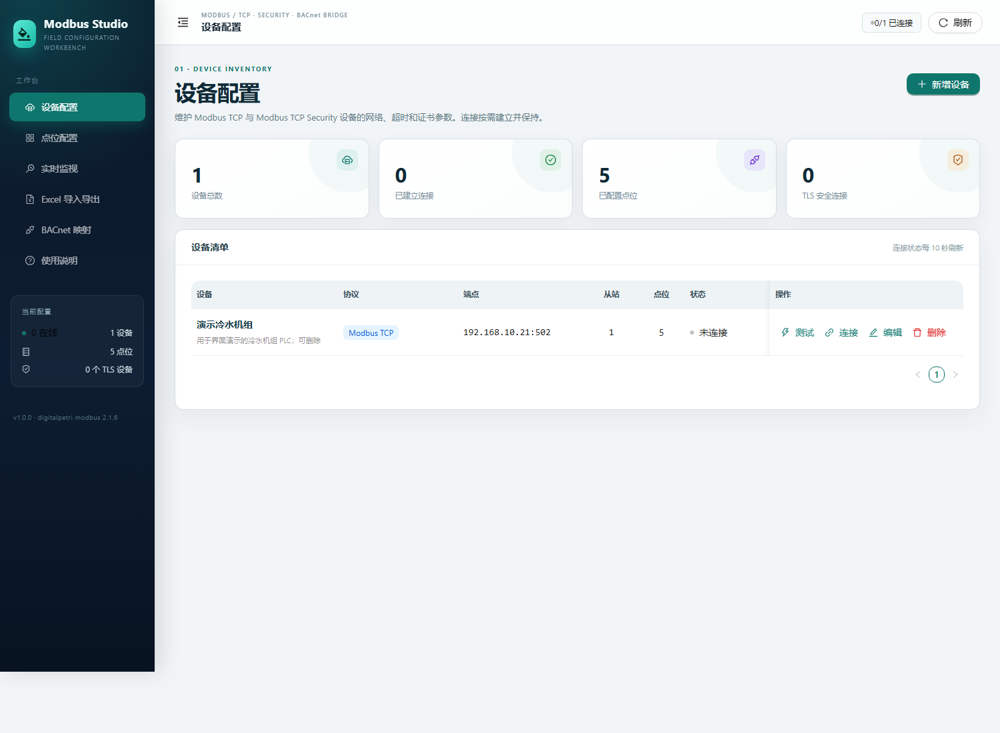
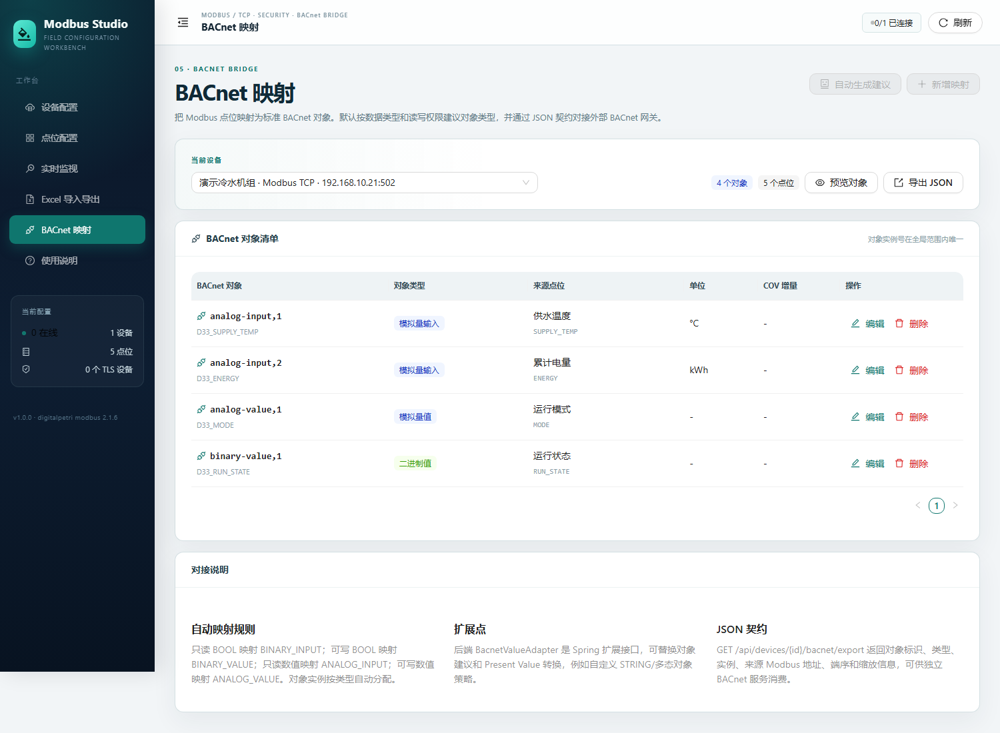

# Modbus Studio

一个通过 Web 管理 Modbus TCP 设备的配置、点位建模、实时读写、Excel 批量导入导出和 BACnet 映射的工具。

- 后端：Java 17、Spring Boot 3.5、Spring Data JPA、H2
- 前端：React 19、TypeScript、Vite、Ant Design 6
- Modbus：`com.digitalpetri.modbus:modbus-tcp:2.1.6`
- Excel：Apache POI 5.5
- 协议：Modbus TCP、Modbus TCP Security（TLS 1.2 / 1.3，双向 TLS）

## 界面预览

| 设备配置 | 点位配置 |
| --- | --- |
|  |  |

| BACnet 映射 | Excel 导入导出 |
| --- | --- |
|  |  |

> 截图使用演示数据。首次启动数据库为空。

## 功能

- 设备配置：主机、端口、从站地址、连接/请求超时、启用状态、TLS 证书。
- 点位配置：
  - 区域：线圈（FC01）、离散输入（FC02）、保持寄存器（FC03）、输入寄存器（FC04）。
  - 类型：BOOL、INT16/UINT16、INT32/UINT32、INT64/UINT64、FLOAT32/FLOAT64、STRING、HEX。
  - 端序：字节序 + 字序，覆盖 ABCD / BADC / CDAB / DCBA 四种常见布局。
  - 寄存器内 BOOL（0..15 位索引）、字符串编码、寄存器数量。
  - 工程值缩放 `value = raw × scale + offset`，写入自动逆变换并做范围检查。
  - 点位级从站地址覆盖。
- 实时监视：整设备逐点读取、质量/耗时/原始数据、5 秒自动刷新、可写点位受控写入并回读。
- Excel：模板下载、全量导出、批量 Upsert 导入；支持“设备 + 点位”双表和带设备列的平铺点位表；先全量校验，发现错误不写库。
- BACnet 映射：
  - 自动建议：只读 BOOL → `BINARY_INPUT`，可写 BOOL → `BINARY_VALUE`，只读数值 → `ANALOG_INPUT`，可写数值 → `ANALOG_VALUE`。
  - 手工编辑对象类型、实例号、对象名、单位、COV 增量。
  - 导出带 Modbus 来源元数据的 BACnet JSON 契约。
  - `BacnetValueAdapter` Spring 扩展点，可替换对象建议和 Present Value 转换。
- 无 Lombok，DTO/实体显式实现；H2 文件数据库开箱即用。

## 快速开始（Windows）

要求：Java 17+、Node.js 20+。Maven 不需要预装，项目带 Maven Wrapper。

```powershell
# 构建前端 + 后端，并打包为一个可执行 JAR
.\build.cmd

# 启动，默认 http://127.0.0.1:8080
.\run.cmd
```

如果系统允许执行 PowerShell 脚本，也可以直接使用 `.ps1` 版本；否则 `.cmd` 包装器会自动以 `-ExecutionPolicy Bypass` 调用。

跳过测试：

```powershell
.\build.cmd -SkipTests
```

指定端口：

```powershell
.\run.cmd -Port 9090
```

开发模式（两个终端）：

```powershell
.\dev-backend.cmd
.\dev-frontend.cmd
```

前端开发地址：`http://127.0.0.1:5173`，Vite 将 `/api` 代理到 `8080`。

构建产物：`backend/target/modbus-web.jar`。前端构建结果会在 `prepare-package` 阶段复制进 JAR 的 `static/`，生产环境只需要运行 JAR。

## 手动构建

```powershell
cd frontend
npm.cmd install
npm.cmd run build

cd ..\backend
.\mvnw.cmd clean package
java -jar target\modbus-web.jar
```

## 数据与配置

默认数据库为 H2 文件库：

```text
./data/modbus-web.mv.db
```

可通过环境变量覆盖：

| 环境变量 | 默认值 | 说明 |
| --- | --- | --- |
| `SERVER_PORT` | `8080` | Web 端口 |
| `DB_URL` | `jdbc:h2:file:./data/modbus-web;DB_CLOSE_ON_EXIT=FALSE` | JDBC URL |
| `DB_USERNAME` | `sa` | 数据库用户 |
| `DB_PASSWORD` | 空 | 数据库密码 |
| `H2_CONSOLE` | `true` | 是否启用 `/h2-console` |
| `CORS_ALLOWED_ORIGINS` | Vite 开发地址 | 允许的跨域来源 |

H2 控制台：`http://127.0.0.1:8080/h2-console`，JDBC URL 使用 `DB_URL` 的值。

## Modbus TCP Security

`digitalpetri` 的 TLS 客户端使用双向 TLS（mTLS），与服务端 `ClientAuth.REQUIRE` 对应。设备配置需要：

| 字段 | 说明 |
| --- | --- |
| 客户端证书 | PEM，可包含证书链 |
| 客户端私钥 | PEM；支持 PKCS#8、加密 PKCS#8、PKCS#1 RSA/EC、传统加密 PEM |
| 私钥密码 | 私钥未加密时留空 |
| CA 证书 | 用于校验服务端证书的 CA PEM |
| 校验证书主机名 | 开启后使用 HTTPS 主机名校验规则（支持 DNS SAN / IP SAN） |

证书路径是**后端进程所在主机**的本地路径，不是浏览器所在电脑的路径。

用 OpenSSL 生成一套测试 mTLS 证书的示例：

```bash
# CA
openssl req -x509 -newkey rsa:2048 -nodes -days 3650 \
  -keyout ca.key -out ca.crt -subj "/CN=Modbus Test CA"

# 服务端（SAN 必须包含客户端实际连接的主机名/IP）
openssl req -newkey rsa:2048 -nodes -keyout server.key -out server.csr -subj "/CN=127.0.0.1"
printf "subjectAltName=IP:127.0.0.1,DNS:localhost\n" > server.ext
openssl x509 -req -in server.csr -CA ca.crt -CAkey ca.key -CAcreateserial \
  -days 3650 -out server.crt -extfile server.ext

# 客户端
openssl req -newkey rsa:2048 -nodes -keyout client.key -out client.csr -subj "/CN=modbus-web"
openssl x509 -req -in client.csr -CA ca.crt -CAkey ca.key -CAcreateserial \
  -days 3650 -out client.crt
```

在设备表单中分别填写 `client.crt`、`client.key`、`ca.crt` 的绝对路径。

## 地址约定

点位地址在数据库中始终存储为 **0-based 协议地址**（0..65535）。

界面和 Excel 会同时展示传统参考地址：

| 区域 | 参考地址起点 | 例：协议地址 0 |
| --- | --- | --- |
| 线圈 | 00001 | 00001 |
| 离散输入 | 10001 | 10001 |
| 输入寄存器 | 30001 | 30001 |
| 保持寄存器 | 40001 | 40001 |

Excel 导入的“地址格式”：

- `ZERO_BASED`：直接使用 0..65535。
- `MODBUS_REFERENCE`：使用 5 位参考地址，如 40001 → 0。
- 留空：保持寄存器 ≥40001、输入寄存器 ≥30001、离散输入 ≥10001 时按参考地址识别；线圈建议显式指定，避免 `1` 与 `00001` 歧义。

## 端序

寄存器数据按以下顺序转换：

1. 每个 16 位字内部按“字节序”交换。
2. 多寄存器按“字序”重排。
3. 按大端解析数值。

| 布局 | FLOAT32 = 1.0 的字节 | 字节序 | 字序 |
| --- | --- | --- | --- |
| ABCD | `3F 80 00 00` | BIG_ENDIAN | BIG_ENDIAN |
| BADC | `80 3F 00 00` | LITTLE_ENDIAN | BIG_ENDIAN |
| CDAB | `00 00 3F 80` | BIG_ENDIAN | LITTLE_ENDIAN |
| DCBA | `00 00 80 3F` | LITTLE_ENDIAN | LITTLE_ENDIAN |

写入执行完全对称的逆变换。

## Excel 结构

模板包含三个工作表：

### 设备

`设备名称`、`协议`、`IP地址`、`端口`、`从站地址`、`连接超时(ms)`、`请求超时(ms)`、`启用`、`TLS客户端证书`、`TLS客户端私钥`、`私钥密码`、`TLS CA证书`、`校验主机名`、`描述`

### 点位

`设备名称`、`点位编码`、`点位名称`、`区域`、`地址`、`地址格式`、`数据类型`、`字节序`、`字序`、`端序`、`位索引`、`寄存器数量`、`字符串编码`、`缩放系数`、`偏移量`、`小数位`、`单位`、`读写权限`、`从站地址`、`启用`、`描述`

### 导入行为

- 设备按名称、点位按“设备名称 + 点位编码”Upsert。
- 支持 `.xlsx` 和 `.xls`，支持公式单元格。
- 全量校验通过后才写库；任何 ERROR 都会导致整份文件不导入。
- 支持无“设备”表的平铺点位表：如果设备不存在且行内有 IP 地址，会自动创建设备；已有设备不会被平铺表覆盖。
- 导出不包含私钥密码。

## BACnet 对接

REST：

```http
GET  /api/devices/{id}/bacnet/mappings
POST /api/devices/{id}/bacnet/generate
GET  /api/devices/{id}/bacnet/preview?includeValues=true
GET  /api/devices/{id}/bacnet/export?includeValues=false
POST /api/bacnet/mappings
PUT  /api/bacnet/mappings/{mappingId}
DELETE /api/bacnet/mappings/{mappingId}
```

`/bacnet/export` 返回 `X-BACnet-Contract-Version: 1`，对象包含：

- `objectId`：如 `analog-input,1`
- `objectType`、`objectInstance`、`objectName`
- `presentValueType`、`presentValue`
- 来源 `source`：设备、端口、从站、区域、地址、类型、端序、缩放、偏移

后端扩展接口：

```java
public interface BacnetValueAdapter {
  BacnetObjectType suggestObjectType(ModbusPoint point);
  AdapterResult toPresentValue(
      ModbusPoint point,
      BacnetObjectType objectType,
      ModbusValueCodec.DecodedValue value);
  boolean supports(ModbusPoint point, BacnetObjectType objectType);
}
```

注册自定义 Spring Bean 即可覆盖默认实现。当前标准对象类型：Analog Input/Output/Value、Binary Input/Output/Value、Multi-state Input/Output/Value。

## REST 概览

| 方法 | 路径 | 说明 |
| --- | --- | --- |
| GET | `/api/meta` | 枚举、限制、端序预设 |
| GET | `/api/health` | 健康检查 |
| GET/POST | `/api/devices` | 设备列表/创建 |
| PUT/DELETE | `/api/devices/{id}` | 更新/删除 |
| POST | `/api/devices/{id}/test` | 建链测试（含 TLS 握手） |
| POST | `/api/devices/{id}/connect` | 主动连接 |
| POST | `/api/devices/{id}/disconnect` | 断开 |
| GET | `/api/devices/{id}/points` | 点位列表 |
| POST | `/api/devices/{id}/points` | 创建点位 |
| POST | `/api/devices/{id}/read-all` | 读取全部启用点位 |
| POST | `/api/points/{id}/read` | 读取单点 |
| POST | `/api/points/{id}/write` | 写入单点并回读 |
| GET | `/api/excel/template` | 下载模板 |
| GET | `/api/excel/export` | 导出配置 |
| POST | `/api/excel/import` | 导入配置（multipart `file`） |

## 代码结构

```text
backend/
  src/main/java/com/modbusweb/
    domain/            枚举与 JPA 实体
    repository/        Spring Data JPA
    service/           设备、点位、读写、TLS、值编解码
    service/bacnet/    BACnet 映射与扩展 SPI
    service/excel/     POI 导入导出
    web/               REST Controller / DTO / 异常处理
frontend/
  src/pages/           设备、点位、监视、Excel、BACnet、说明
  src/App.tsx          布局与导航
```

## 测试

```powershell
cd backend
.\mvnw.cmd test
```

测试包含：

- 四种端序下 FLOAT32 的编解码往返。
- 缩放/偏移、整数范围、UINT64 精度、STRING、寄存器位、布尔别名。
- 使用本地 digitalpetri Modbus TCP 测试服务器完成端到端：建设备 → 建点位 → 全部读取 → 写入回读 → BACnet 自动映射/预览 → Excel 导出 → 导入回环 → 删除。
- 使用 BouncyCastle 动态生成 CA/服务端/客户端证书，启动双向 TLS 的 digitalpetri Modbus TCP Security 服务端，验证客户端证书加载、TLS 握手和 IP SAN 主机名校验。

## 当前限制

- 不包含用户认证，请部署在可信管理网络，必要时在反向代理层增加认证。
- 只支持 Modbus TCP / Modbus TCP Security，不支持 RTU/串口。
- 未实现 FC22 掩码写、FC23 读写组合寄存器。
- 单点读取最大 125 寄存器；写入最大 123 寄存器；不支持跨 65536 回绕。
- STRING/HEX 默认没有标准 BACnet 对象映射，需要自定义 `BacnetValueAdapter`。
- TLS 证书路径由后端读取，浏览器不能上传证书。
